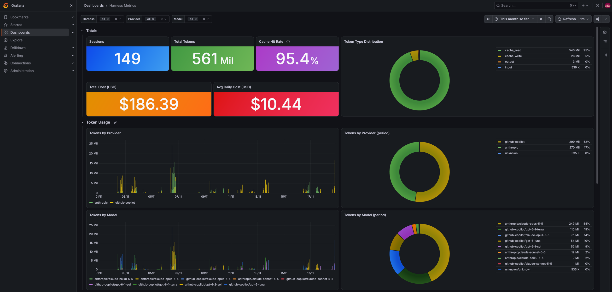

# Harness Meter

Token usage, cost, and session metrics for coding harnesses, in one Grafana dashboard. Harness Meter reads [OpenCode](https://github.com/anomalyco/opencode) (v1 and v2) databases and [Pi](https://pi.dev) session files read-only, and exports their usage to Prometheus.



## Quick start

Requires Docker with Docker Compose.

```bash
docker compose up -d --build
```

- **Grafana**: http://localhost:3100 (no login)
- **Prometheus**: http://localhost:9090

The exporter imports all available history on the first run, then polls every 60 seconds. Both ports are bound to `127.0.0.1` because Grafana runs without a login and Prometheus has no authentication. Do not expose them without adding authentication.

### Sources

Compose mounts these read-only:

| Harness | Default host path |
| --- | --- |
| OpenCode | `~/.local/share/opencode/opencode.db` (plus `-wal` and `-shm`) |
| Pi | `~/.pi/agent/sessions/` |

All paths must exist; start OpenCode once before the first run. To use other locations, set `OPENCODE_HOST_DIR` (the directory containing `opencode.db`) or `PI_SESSIONS_HOST_DIR` in a `.env` file.

To use only one harness, override the exporter's volumes and disable the other source. For example, Pi only:

```yaml
# compose.override.yaml
services:
  metrics-exporter:
    volumes: !override
      - type: bind
        source: ${HOME}/.pi/agent/sessions
        target: /data/pi-sessions
        read_only: true
      - harness_metrics_state:/state
    environment:
      OPENCODE_DB: ""
```

## Dashboard and metrics

Filter by **Harness** (`opencode_v1`, `opencode_v2`, `pi`), **Provider**, and **Model**. The default range is the last 90 days, and filters only list values with data in the selected range.

| Metric | Labels | Meaning |
| --- | --- | --- |
| `harness_usage_tokens` | `harness`, `provider`, `model`, `type` | Tokens by `type`: `input`, `output`, `cache_read`, `cache_write` |
| `harness_usage_cost_usd` | `harness`, `provider`, `model` | Cost reported by the harness (not necessarily what you are billed) |
| `harness_session_count` | `harness`, `provider`, `model` | One per session, at its first usage |

Cache hit rate is `cache_read / (input + cache_read + cache_write)`.

How usage is counted:

- Only completed usage is counted, including zero-cost usage such as subscription models.
- **OpenCode:** after an upgrade, the v1 tables remain, and some v1 messages may not be copied to v2. Both are read. Messages in the v1 tables count as `opencode_v1`; messages only in v2 count as `opencode_v2`.
- **Pi:** all recorded usage counts, including tool calls, cache warming, compaction, and branch summaries. Usage without a provider or model is labeled `unknown`. History copied into forks is counted once.
- Restarts and retries never count usage twice.

The reasons for these rules are in the [decision records](docs/decisions/index.md).

## Configuration

Exporter environment variables (most are set in `docker-compose.yml`):

| Variable | Default | Description |
| --- | --- | --- |
| `OPENCODE_DB` | `/data/opencode/opencode.db` | Comma-separated OpenCode database paths in the container. Empty disables OpenCode. |
| `PI_SESSIONS_DIR` | `/data/pi-sessions` | Pi sessions directory in the container. Empty disables Pi. |
| `POLL_INTERVAL_MS` | `60000` | Delay between polling cycles |
| `BATCH_SIZE` | `500` | Time series per remote-write request |
| `METRIC_POINT_RETENTION_DAYS` | `730` | Delivered samples older than this are pruned from the exporter state |

To also import an archived OpenCode database:

```yaml
# compose.override.yaml
services:
  metrics-exporter:
    volumes:
      - /path/to/archive/opencode.db:/data/archive/opencode.db:ro
    environment:
      OPENCODE_DB: /data/opencode/opencode.db,/data/archive/opencode.db
```

Prometheus keeps data for two years and accepts samples up to 300 days out of order (see `prometheus.yml`).

## Rebuilding history

Metrics are always rebuilt from the source files, so Prometheus data can be recreated at any time. To re-import, for example after adding a database, remove the `harness_prometheus_data` and `harness_metrics_state` volumes and start the stack again. Keep `grafana_data`, and do not use `docker compose down -v`, which also deletes it.

Usage that has been deleted from the sources cannot be re-imported.

Volume names are prefixed with the Compose project name, which defaults to the directory name. If you move the repository to a directory with a different name, set `COMPOSE_PROJECT_NAME` to the old name to keep your data.

## Development

```bash
cd metrics
bun install --frozen-lockfile
bun test
bun run typecheck
```

Use Bun 1.4.4, matching the Docker image. Tests use temporary fixtures and never touch real harness data.

Architecture decisions are recorded in [`docs/decisions/`](docs/decisions/index.md). Read the relevant records before changing related code.

## Troubleshooting

- **No metrics appear:** run `docker compose logs --tail=100 metrics-exporter`. Each cycle logs how many events were imported per harness.
- **`bind source path does not exist`:** a source path is missing. Start OpenCode once, change `OPENCODE_HOST_DIR`/`PI_SESSIONS_HOST_DIR`, or disable that source.
- **A harness is missing from the filter:** widen the time range.
- **Samples rejected by Prometheus:** the exporter logs `rejected these samples permanently`. They are usually older than the out-of-order window.
- **Exporter exits with code 133** (`embedder failed to suspend thread`): rebuild with `docker compose up -d --build`. The image pins Bun 1.4.4 to avoid this Bun 1.3.14 crash.

## Cleanup

```bash
docker compose down     # stop, keep data
docker compose down -v  # stop and delete all data, including Grafana settings
```
